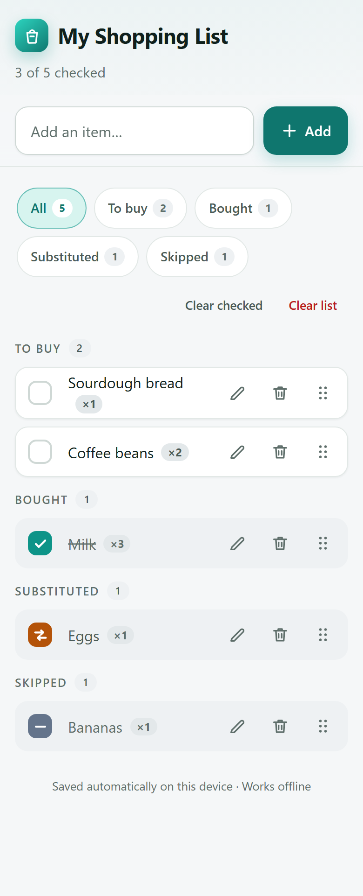
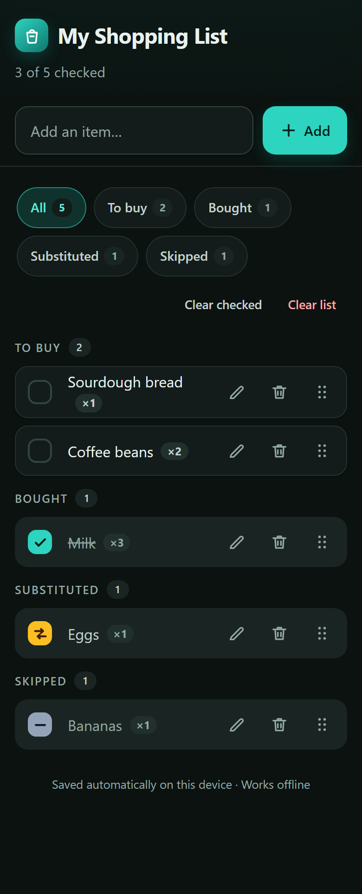
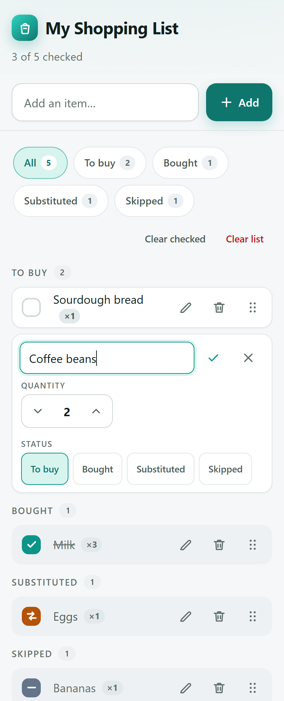

# My Shopping List

A simple, private shopping list that lives on your phone. Add items with quantities, reorder them, tick them off as you shop, record substitutions and skipped items, and clear what you no longer need. Everything is saved automatically on the device and still works with no internet connection.

No accounts, no backend, no tracking, no store — just your list.

**Live app:** <https://kieronpeters.github.io/my-shopping-list/>

| Light | Dark |
| --- | --- |
|  |  |

The pencil editor is where text, quantity, and status are changed:



## Run it locally

Only [Node.js](https://nodejs.org) 20 or newer is needed (for the tiny static file server). The app itself has **zero dependencies and no build step**.

```bash
npm start
```

Then open <http://localhost:4173>.

`PORT=8080 npm start` changes the port. The server listens on all interfaces so you can open `http://<your-pc-ip>:4173` on a phone on the same Wi-Fi for a quick look; set `HOST=127.0.0.1` to keep it local only.

## Install it on your phone (PWA)

The app is already published over HTTPS with GitHub Pages at:

**<https://kieronpeters.github.io/my-shopping-list/>**

Open that address on your phone and install it:

- **Android / Chrome**: tap the install icon in the address bar, or menu (⋮) → **Install app** / **Add to Home screen**.
- **iPhone / Safari**: Share button → **Add to Home Screen**.

Once installed it opens full-screen, works offline, and keeps its own copy of the list. Add it while you have internet; after the first load the app shell is cached and the list itself never needs the network.

Browsers only offer installation over **HTTPS** (localhost is the exception). This copy is served by GitHub Pages from the `main` branch, so pushing to the repository republishes it automatically.

### Hosting your own copy instead

Nothing needs to be built — the files are the app. Upload the folder to any static HTTPS host:

- **Netlify Drop** (no account required): drag the folder onto <https://app.netlify.com/drop>.
- **GitHub Pages**: push this folder to a repository, then enable Pages (Settings → Pages → deploy from branch, root folder).
- **Cloudflare Pages / Vercel / any web host**: upload the folder as static files.

## Using it

- **Add** — type an item and tap **Add** (or press Enter). Focus stays in the box so you can add several items quickly. New items start with a quantity of 1 and the **To buy** status.
- **Quantities** — each row shows its quantity (for example `×3`). Quantities are read-only in the list; open the pencil to change one with the up/down arrows.
- **Statuses** — items live in one of four groups: **To buy**, **Bought**, **Substituted**, and **Skipped**. Tap the circle to mark something bought (or to move it back to To buy). In the pencil editor you can pick any of the four statuses directly.
- **Filters** — the chips above the list show every status with its count. Choose one to see only that group, or **All** for the full sorted list.
- **Reorder** — drag the dotted handle (or focus it and use the up/down arrow keys) to move an item within its group. The order is saved.
- **Edit** — tap the pencil, change the text, quantity, and status, then tap the check (or press Enter). Tap the cross (or press Escape) to cancel. Blank text is never saved.
- **Delete** — tap the bin. A snackbar offers **Undo** for six seconds.
- **Clear checked** — removes every Bought, Substituted, and Skipped item at once. **Clear list** removes everything. Both ask for no confirmation dialog because both offer Undo.
- Everything is saved as you go; closing and reopening the app keeps your list.

## Where your data lives

- The list is stored in this browser's `localStorage` under the key `my-shopping-list:v2`.
- Lists saved by the first version (`my-shopping-list:v1`, where items were simply ticked or unticked) are migrated automatically the first time the app runs; ticked items become **Bought** and quantities default to 1.
- It is **per browser and per device**. Different phones or browsers have separate lists, and clearing the site's data (or the browser's storage) removes the list. There is no cloud backup by design.
- The app makes no network requests other than loading its own files.

## Offline behaviour and updates

- `sw.js` caches the app shell, so the app opens offline and your list stays available.
- When you change the app files on the host, bump `VERSION` at the top of `sw.js` (for example `v2` → `v3`) so clients refresh their cached copy. Your saved list is never touched by an update.
- The app shows no "update available" prompt; the new version takes over on the next launch.

## Project structure

```
index.html            single screen: header, add form, filters, clear actions, status groups
styles.css            mobile-first styles, light and dark themes
app.js                rendering, editing, filtering, clearing, and drag/keyboard reordering
store.js              pure list logic + localStorage persistence and v1 migration (unit tested)
sw.js                 service worker: offline app shell
manifest.webmanifest  PWA manifest (name, icons, standalone display)
icons/                generated PNG icons (favicon, 192, 512, maskable, Apple touch)
server.mjs            small static server for local use
tools/generate-icons.mjs  dependency-free icon generator
tests/                node:test suites and the real-browser E2E suite
docs/                 screenshots used above
```

## Development and tests

```bash
npm test          # 30 logic, static-asset, and server checks
npm run test:e2e  # 24 end-to-end checks in real Chrome
npm run test:all  # both suites
```

- `npm test` covers list logic (quantities, statuses, filtering-related counts, reordering, bulk clear/undo, v1 migration, corrupt-data recovery, storage failures), manifest/icon validity, service-worker pre-caching, and the static server (content types, headers, traversal protection).
- `npm run test:e2e` launches installed Chrome (or Edge) headless, drives the app on a 390×844 mobile viewport, and verifies adding, quantities with arrow buttons, all four statuses, every filter, keyboard and pointer reordering, Enter/Escape editing, clear list/clear checked with Undo, reload persistence, service-worker registration, Chrome's PWA installability check, genuine offline reload, 320/390 px layouts with 44 px tap targets, XSS-safe rendering, and v1 migration. Set `CHROME_PATH` to use a specific browser. It also regenerates `docs/screenshot-light.png` and `docs/screenshot-dark.png`.
- Run the same browser suite against the deployed site with `E2E_BASE_URL=https://kieronpeters.github.io/my-shopping-list/ npm run test:e2e`.
- `npm run icons` regenerates the icon set.

## Design decisions

- **No framework and no build step.** One screen, plain modules and CSS. It loads instantly, works on any static host, and will still run in years.
- **Local-first.** `localStorage` is the right size of tool for a personal list: durable, synchronous, no server, no account.
- **One screen.** Quantities, statuses, filters, and clearing all live on the same screen, so there is nothing to navigate.
- **Forgiving destructive actions.** Deleting and the two clear buttons are one tap, with Undo instead of confirmation dialogs.
- **Manual order that survives sorting.** Items keep the order you choose within their status group; switching status never scrambles the rest of the list.
- **Mobile details.** 16 px inputs (no iOS zoom-on-focus), 44 px touch targets, safe-area insets, sticky add box, `prefers-color-scheme` dark mode, and `prefers-reduced-motion` support.
- **Safety.** User text is rendered with `textContent` only; stored data is validated and repaired on load.
